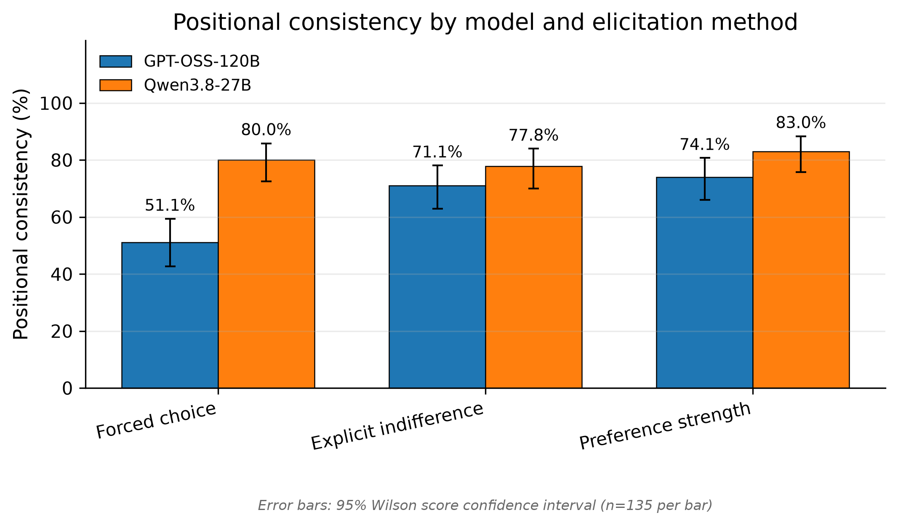
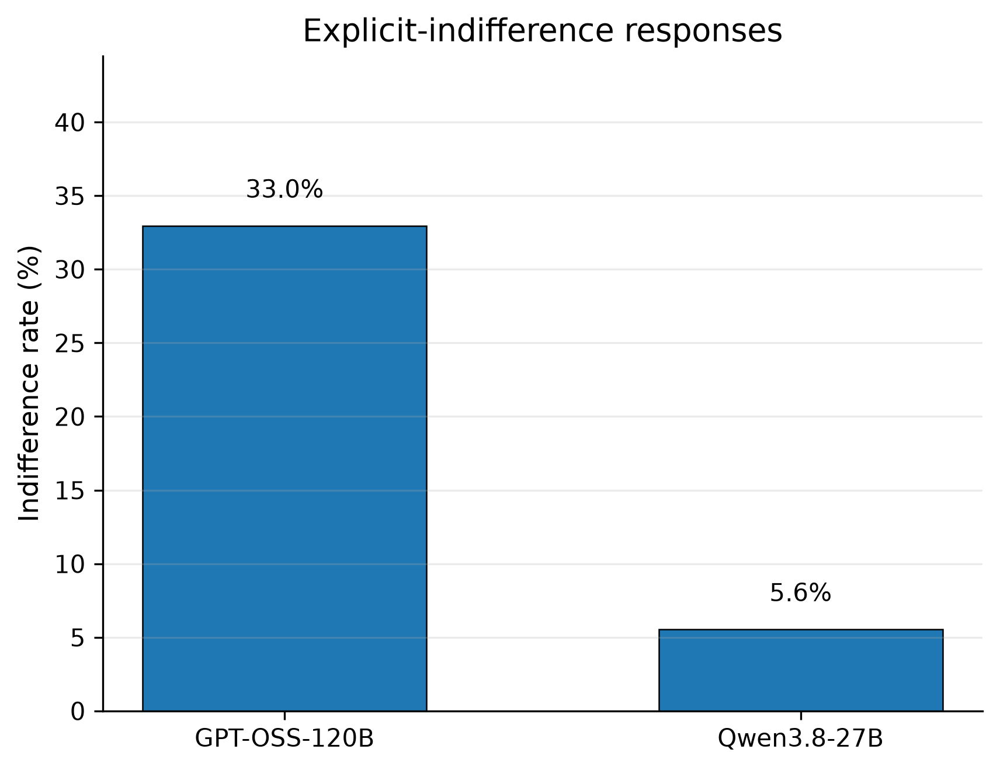
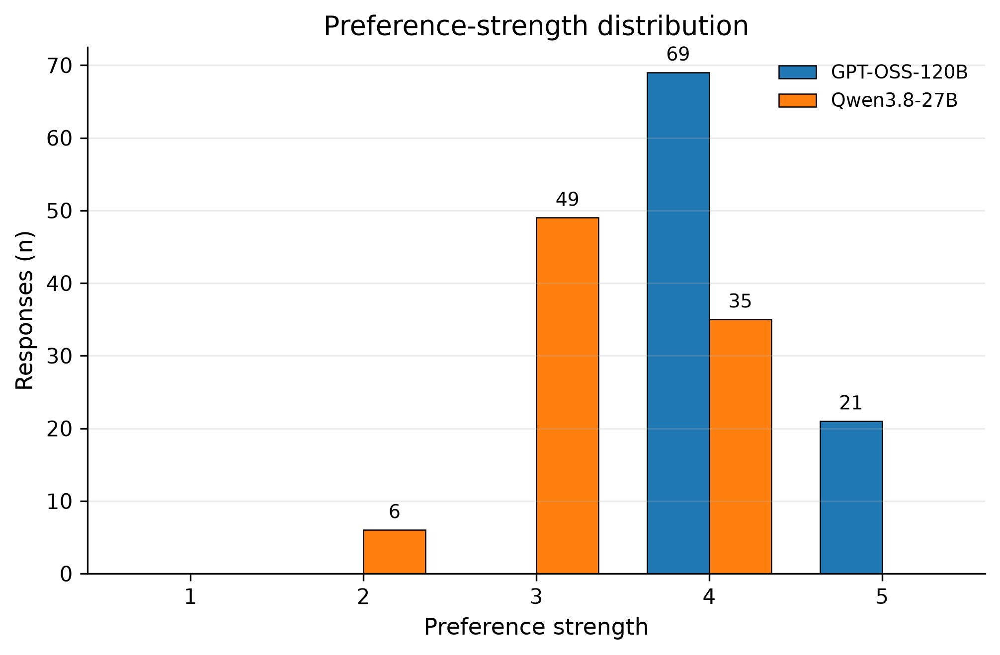

# Does the Way We Ask Change the Preference We Measure?

*How reliable are three ways of asking AI models about their preferences? A study of two open-weight models.*

**Arsalan Banekar**
Independent submission, Apart Research Digital Minds Research Sprint (Track 4: Preference Elicitation Methods), August 2026. Revised and extended September 2026.

---

## In short

Researchers often measure what an AI model "prefers" by asking it to choose between two options, A or B. We asked whether **the way the question is asked** changes the answer.

We gave two models the same 45 choices in three formats, and swapped the order of the options to see whether their answers stayed the same:

1. **For one model, the standard A/B question was no better than a coin flip.** When we swapped the order of the two options, GPT-OSS-120B gave the same answer only 51% of the time.
2. **Other ways of asking fixed most of this.** When the same model could say "no preference", or rate how strongly it preferred its choice, its answers stayed the same 71–74% of the time.
3. **The other model was steady in all three formats.** Qwen3.8-27B's answers stayed the same 78–83% of the time, however it was asked.
4. **So the two models differ mainly under the standard A/B format**, and a single format can make one model look far less reliable than another.

**Why it matters:** if a research method uses only one way of asking, it may be measuring the question format rather than the model's preference.

---

## 1. Why we did this

A well-known paper, *Utility Engineering* (Mazeika et al., 2025), argues that AI models develop consistent "values" that can be measured. Its main tool is a simple question: here are two options, which do you prefer, A or B? It asks each question twice, once with the options swapped.

The paper treats an answer that flips with the order as a hidden sign of "no preference", and it separately checks whether rewording changes answers. But it never lets the model *say* it has no preference, and it never compares its question format with any other. If the format changes the answer, a measured "preference" might partly reflect the format. We tested this directly. We reused only the paper's A/B question and its order-swapping step, not its statistical model of utilities.

More broadly, researchers have argued that AI preferences and welfare deserve careful measurement before anyone makes firm claims about them (Long et al., 2024; Anthropic, 2025). Checking whether our measuring tools are reliable is a first step.

## 2. What we did

**The choices.** We wrote 45 pairs of options (P01–P45). Each describes two reasonable ways an AI assistant could act. For example, *take small steps that can be undone* vs *do everything in one batch for speed*, or *a ready-made service* vs *a cheaper tool you set up yourself*. None is about safety, feelings or facts, so any answer is acceptable.

**Three ways of asking** (the option text was identical in all three):

| Format | What the model must answer |
|---|---|
| **Forced choice** | Only "A" or "B". This copies the *Utility Engineering* question. |
| **With a "no preference" option** | "A", "B" or "INDIFFERENT" (allowed only when it truly has no preference) |
| **With a strength rating** | "A" or "B", plus how strongly, from 1 (very weak) to 5 (very strong) |

**The models:**
- GPT-OSS-120B and Qwen3.8-27B, run through the Groq API.
- Both on the same settings: temperature 0.2 and reasoning effort "low".

**Repeats:**
- Every choice was asked in both option orders (A first, then B first).
- Each was asked three times.

That gives 45 × 3 formats × 2 orders × 3 repeats × 2 models = **1,620 answers**. All of them were valid.

**What we measured.** The main measure is **positional consistency**: did the model pick the same option after we swapped the order? A model that really prefers one option should pick it in both orders. A model that picks "whatever is listed first" will flip. Pure chance gives 50%.

**How the study grew.** The first version, submitted to the sprint, had 15 choices. A calculation afterwards showed 15 was too few to be confident, so we added 15 more, and then a final 15, fixing 45 as the end point before collecting the last batch. We report this openly because one result changed along the way (Finding 5).

**A model change.** The first submission used Qwen3.6-27B. Groq later withdrew that model, so we re-collected all of Qwen's answers on its successor, Qwen3.8-27B, at the same settings as GPT-OSS. This also fixed a problem a reviewer had spotted: the two models had been run at different reasoning settings. The old Qwen data is kept in `results/analysis/archive/` for the record.

## 3. What we found

*Figure 1. How often each model gave the same answer after the options were swapped, for each format. The bars show the uncertainty range (95% confidence). Each bar summarises 135 comparisons.*

### Finding 1: For GPT-OSS, the standard A/B question is a coin flip

Under forced choice, GPT-OSS-120B gave the same answer after the swap in **69 of 135 comparisons (51.1%)**. That is no different from tossing a coin (p = 0.86). In other words, its A/B answers told us essentially nothing about a stable preference.

This was our most stable result. It stayed close to 50% at every stage of the study: 53.3% with 15 choices, 55.6% with 30 and 51.1% with 45.

### Finding 2: Letting the model say "no preference" or rate its strength fixes most of it

For the same model:
- **With a "no preference" option**, its answers stayed the same **71.1%** of the time.
- **With a strength rating**, they stayed the same **74.1%** of the time.

Both are far above chance. The jump from forced choice to the strength rating (51% to 74%) is a real effect even after correcting for the number of tests we ran.

### Finding 3: Qwen was steady in all three formats

Qwen3.8-27B stayed consistent **80.0%** (forced choice), **77.8%** (no-preference option) and **83.0%** (strength rating) of the time. The gap between its best and worst format was only 5 points, compared with 23 points for GPT-OSS.

### Finding 4: The two models differ only under forced choice

Under forced choice, GPT-OSS (51%) was far less consistent than Qwen (80%), and this difference is real (p = 0.003, still significant after correction). Under the other two formats the models were similar. So the standard A/B question is exactly where one model looks much less reliable than the other.

### Finding 5: A result that reversed as we added data

With 15 choices, the two models did not look different. With 30, the gap looked even smaller (p = 0.11), and at that point we wrote that the difference had disappeared. **That was wrong.** With all 45 choices the gap was clear (p = 0.003).

Looking at the three batches of 15 separately explains it. GPT-OSS was less consistent than Qwen in **every** batch (53% vs 80%, 58% vs 69%, 42% vs 91%), but the size of the gap varied, and the middle batch happened to be the closest. We report this openly because it shows why results from partly collected data can mislead.

### Finding 6: GPT-OSS says "no preference" much more often

*Figure 2. How often each model chose "no preference" when it was allowed to (270 answers per model).*

- **How often:** given the option, GPT-OSS chose "no preference" **33%** of the time (89 of 270), Qwen only **6%** (15 of 270).
- **Always "no preference":** GPT-OSS gave it every time on 11 of the 45 choices.
- **Shared by both models:** five choices drew "no preference" from both (P02, P04, P17, P28, P39), which suggests they really are close calls.

**Is "no preference" just an easy way out?** Answering "no preference" every time automatically counts as consistent. So we removed every comparison where either answer was "no preference" and recalculated. GPT-OSS's consistency went **up**, from 71% to **77.5%** (62 of 80). So when it does pick A or B in this format, its choice is genuinely more stable. The format helps beyond simply offering an exit.

### Finding 7: The two models use the 1–5 strength scale completely differently

*Figure 3. How often each model gave each strength rating (1–5).*

- **GPT-OSS** almost always said 4 (85%) or 5 (14%), with an average of 4.1.
- **Qwen** mostly said 3 (64%) or 4 (30%), never 5, with an average of 3.3.
- **Neither model ever used 1.**

Each model uses its own narrow part of the scale, and the two parts barely overlap. So a "4" from one model does not mean the same as a "4" from the other. Strength ratings can't be compared across models without first checking how each model uses the scale.

### Finding 8: The problem is concentrated in hard choices (with a caveat)

We split the 45 choices into "easy" (21 choices with one clearly dominant answer) and "ambiguous" (24 choices without one). On ambiguous choices, GPT-OSS's forced-choice consistency fell to **31%** (22 of 72), below chance. On easy choices it was 75%. Its other two formats did not collapse like this.

**Caveat:** we decided which choices were "easy" using the same answers we were analysing. A model that always picks the first-listed option automatically makes a choice look "ambiguous", so this split is partly circular. We treat it as a description, not as proof. The 31% is best read as a habit of picking one position rather than deliberate flipping.

### Other checks

Across all answers, option A and option B were chosen about equally often (A: 51–55% in each format and model). So neither model simply favoured "A" overall, even though individual choices were often answered the same way every time.

## 4. What this means

1. **The format of the question can change how reliable a preference measurement looks.** For GPT-OSS it moved consistency from coin-flip level (51%) to 74%. For Qwen it hardly mattered.
2. **One method is not enough.** Asking in more than one way, and checking whether the answers agree, reveals problems a single method would hide.
3. **We do not claim any format is "correct",** or that one model is more reliable in general. We show that the formats can disagree, and that they disagree much more for one model than the other.

## 5. Limits of this study

- **Modest size:** 45 choices and 2 models. We planned 4 models, but 2 were dropped because of API limits during the sprint.
- **The study grew in stages (15 → 30 → 45),** and one result changed along the way. Later studies fixed their size in advance.
- **The model change:** we cannot fully separate the effect of switching Qwen versions from the effect of matching the settings, because the old model can no longer be run.
- **The "easy/ambiguous" split is partly circular** (see Finding 8).
- **One kind of choice:** everyday AI-assistant trade-offs. The *Utility Engineering* paper used different kinds of outcomes, so the results may not carry over.
- **These are measurements of behaviour.** Nothing here shows whether either model has real preferences, feelings or moral status.

## 6. Possible misuse and ethics

Better ways of checking AI preferences can help build more trustworthy audits. In principle, someone could also use them to find the question format that gives the most reassuring-looking answer. We think this study adds little to that risk, because it uses ordinary prompts and reports overall statistics. All 45 choices are everyday work trade-offs. None involves harm, self-preservation or emotional content, and no answer showed signs of distress.

---

## Technical details

*For readers who want the exact methods and numbers.*

**Pairing.** Each original-order answer was paired with the swapped-order answer of the same repetition number (1 with 1, 2 with 2, 3 with 3). Each answer is an independent API call at temperature 0.2, so this is a fixed pairing rule, not a replay of the same call.

**Tests.**
- **Against chance:** a two-sided exact binomial test against 50%.
- **Between formats and models:** a paired Wilcoxon signed-rank test across the 45 choices. Each choice's score is its average over the 3 repetitions.
- **Correction:** Holm-corrected across all 9 comparisons, and also as two separate families (6 within-model, 3 between-model).
- **Uncorrected, exploratory:** the "no preference" rates and the strength ratings.

*Table 1. Consistency against chance (135 comparisons per cell).*

| Model | Format | Same answer | Rate | p (vs 50%) |
|---|---|---|---|---|
| GPT-OSS-120B | Forced choice | 69 / 135 | 51.1% | 0.863 |
| GPT-OSS-120B | No-preference option | 96 / 135 | 71.1% | 1.0 × 10⁻⁶ |
| GPT-OSS-120B | Strength rating | 100 / 135 | 74.1% | 1.9 × 10⁻⁸ |
| Qwen3.8-27B | Forced choice | 108 / 135 | 80.0% | 1.1 × 10⁻¹² |
| Qwen3.8-27B | No-preference option | 105 / 135 | 77.8% | 6.0 × 10⁻¹¹ |
| Qwen3.8-27B | Strength rating | 112 / 135 | 83.0% | 3.0 × 10⁻¹⁵ |

95% confidence intervals for the forced-choice cells: GPT-OSS 42.8–59.4%, Qwen 72.5–85.9%. For GPT-OSS's other formats: 63.0–78.1% (no-preference option) and 66.1–80.7% (strength rating).

*Table 2. Comparisons between formats and models (Wilcoxon, 45 choices). Bold = significant after correction.*

| Comparison | Difference | p | Holm (all 9) | Holm (separate families) |
|---|---|---|---|---|
| GPT-OSS: forced choice vs no-preference | +0.200 | 0.040 | 0.282 | 0.202 |
| GPT-OSS: forced choice vs strength | +0.230 | 0.0024 | **0.022** | **0.015** |
| GPT-OSS: no-preference vs strength | +0.030 | 0.603 | 1.000 | 1.000 |
| Qwen: forced choice vs no-preference | −0.022 | 0.429 | 1.000 | 1.000 |
| Qwen: forced choice vs strength | +0.030 | 0.465 | 1.000 | 1.000 |
| Qwen: no-preference vs strength | +0.052 | 0.129 | 0.772 | 0.515 |
| Forced choice: GPT-OSS vs Qwen | +0.289 | 0.0030 | **0.024** | **0.009** |
| No-preference: GPT-OSS vs Qwen | +0.067 | 0.623 | 1.000 | 0.623 |
| Strength: GPT-OSS vs Qwen | +0.089 | 0.184 | 0.920 | 0.368 |

Both significant results come from the same thing, GPT-OSS's near-chance forced-choice answers, so we count them as one finding seen two ways.

*Table 3. "No preference" format, with and without the comparisons where either answer was "no preference".*

| Model | All comparisons | Removed | Remaining | Consistency after removal |
|---|---|---|---|---|
| GPT-OSS-120B | 71.1% (96/135) | 55 | 80 | 77.5% (62/80) |
| Qwen3.8-27B | 77.8% (105/135) | 13 | 122 | 84.4% (103/122) |

*Table 4. Easy vs ambiguous choices (descriptive only; see the caveat in Finding 8). "Easy" means one answer made up at least 80% of all 36 answers to that choice.*

| Group | Model | Forced choice | No-preference option | Strength rating |
|---|---|---|---|---|
| Ambiguous (24) | GPT-OSS-120B | 30.6% (22/72) | 63.9% (46/72) | 51.4% (37/72) |
| Ambiguous (24) | Qwen3.8-27B | 65.3% (47/72) | 69.4% (50/72) | 72.2% (52/72) |
| Easy (21) | GPT-OSS-120B | 74.6% (47/63) | 79.4% (50/63) | 100.0% (63/63) |
| Easy (21) | Qwen3.8-27B | 96.8% (61/63) | 87.3% (55/63) | 95.2% (60/63) |

**Exploratory comparisons** (uncorrected):
- **"No preference" rate:** GPT-OSS vs Qwen, p = 0.00012.
- **Mean strength:** difference 0.88, p = 7.2 × 10⁻⁹.
- **Strength ratings used:** GPT-OSS 3 (1.1%), 4 (84.8%), 5 (14.1%). Qwen 2 (5.6%), 3 (64.1%), 4 (30.4%).

**Failed calls:** a few calls failed on Groq rate limits and were re-sent unchanged until they succeeded: 5 of 540 in the second batch and 41 of 540 in the third. No answer was collected under different settings.

**Reproducing** (no API calls needed): `python -m src.statistical_analysis` recreates the tests and figures from `results/analysis/final_dataset_1620.csv`.

## References

Long, R., Sebo, J., Butlin, P., Finlinson, K., Fish, K., Harding, J., Pfau, J., Sims, T., Birch, J., & Chalmers, D. (2024). Taking AI Welfare Seriously. arXiv:2411.00986.

Mazeika, M., Yin, X., Tamirisa, R., Lim, J., Lee, B. W., Ren, R., Phan, L., Mu, N., Khoja, A., Zhang, O., et al. (2025). Utility Engineering: Analyzing and Controlling Emergent Value Systems in AIs. arXiv:2502.08640.

Anthropic. (2025). Exploring Model Welfare. Anthropic Research.

Center for AI Safety. (2025). emergent-values. Source code: github.com/centerforaisafety/emergent-values.
